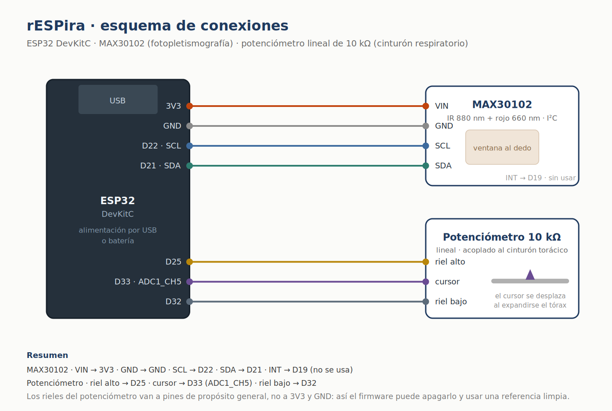
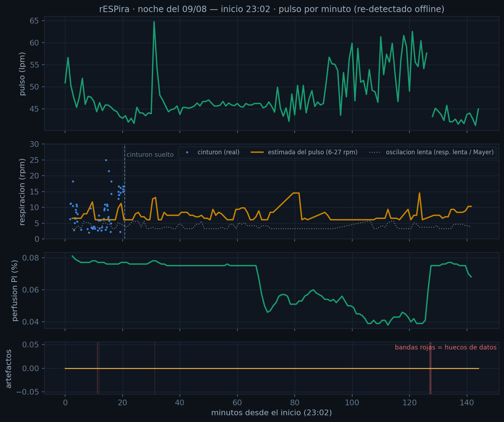
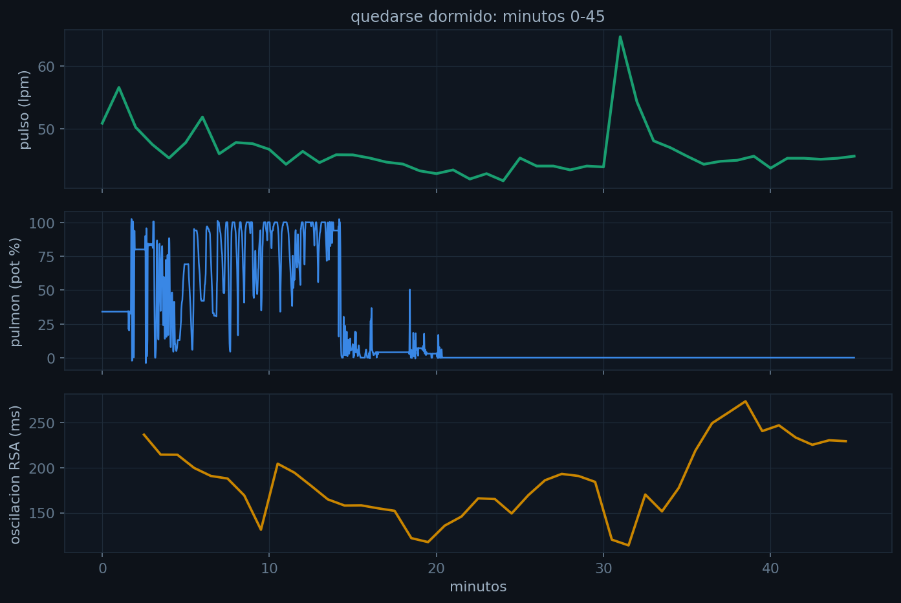
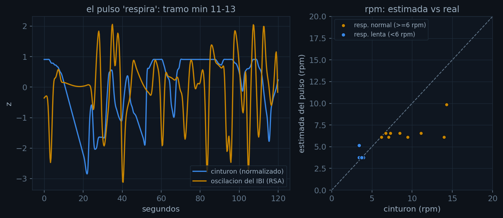
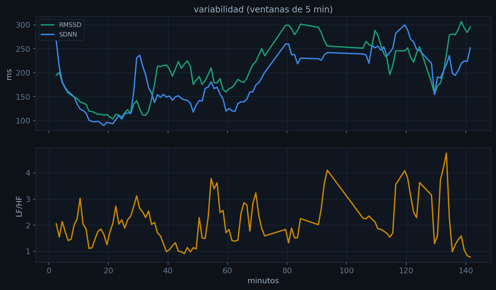
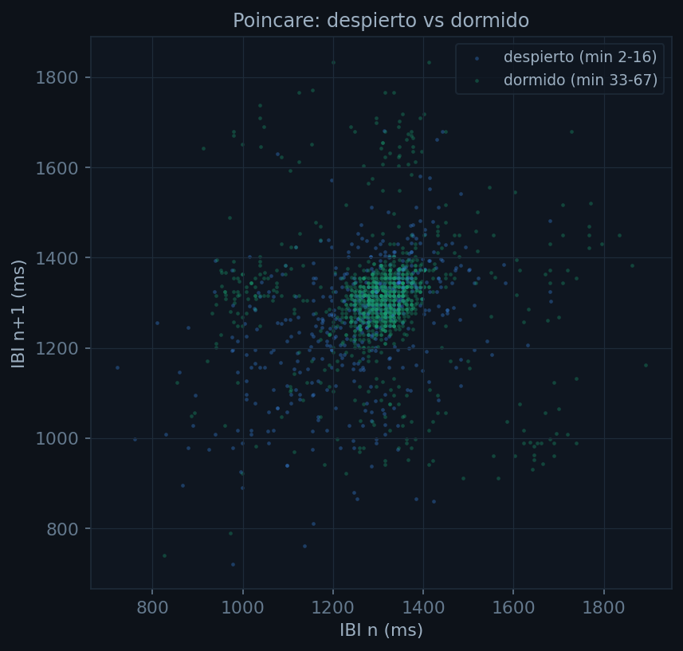
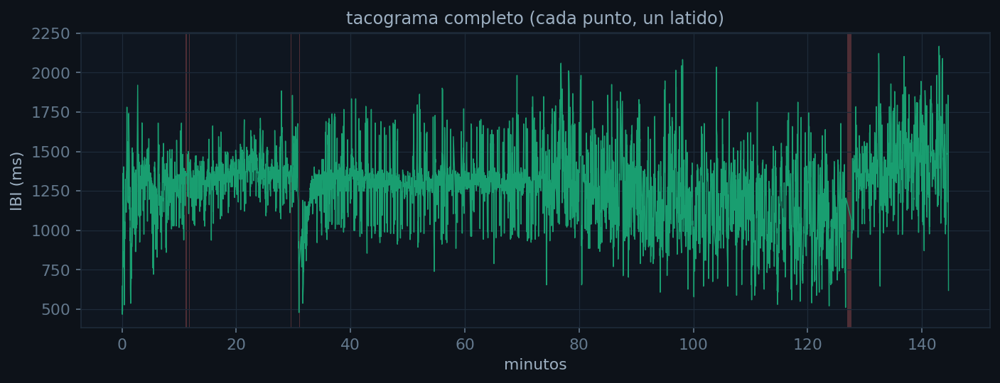

# rESPira

Instrumentación abierta para ver, en tiempo real, cómo se acoplan la respiración
y el corazón.

> **Summary (English):** rESPira is an open instrument that shows, in real time,
> how breathing and heart rate couple (respiratory sinus arrhythmia). An ESP32
> samples a MAX30102 photoplethysmography sensor at 100 Hz and a chest-belt
> potentiometer, detects beats on-device and streams over WebSocket with its own
> clock to an offline Android app; Python tools analyse the recordings. In a
> 144.7-minute overnight session the offline beat detector agreed with the
> firmware within 0.9 % (6402 vs 6458 beats) and respiration estimated from heart
> rate matched the belt with a mean absolute error of 2.5 breaths per minute.
> Not a medical device; validation against a reference-grade amplifier is pending.

Cuando inhalas, tu ritmo cardiaco sube. Cuando exhalas, baja. Eso se llama
arritmia sinusal respiratoria y es la tesis entera de este proyecto: normalmente
hay que calcularla a partir de un registro; aquí se ve mientras ocurre.

Un ESP32 con un sensor óptico en el dedo y un potenciómetro en un cinturón
torácico miden pulso y respiración a la vez. Una aplicación Android sin conexión
a internet dibuja las dos señales en el mismo eje de tiempo y graba la sesión.
Después, un conjunto de herramientas en Python analiza lo grabado.



## Cómo está repartido el trabajo

```
  ESP32                        Teléfono Android                  Computador
  ─────                        ────────────────                  ──────────
  MAX30102 a 100 Hz            interfaz completa                 análisis
  filtro Butterworth           descubre el sensor en la red      figuras
  detección de latido    ───►  graba a la tarjeta         ───►   informes
  potenciómetro (ADC1)         biofeedback visual
  WebSocket + su reloj
```

El sensor solo mide y envía. Todo lo demás vive en el teléfono.

Ese reparto es la corrección más importante del proyecto y no fue una decisión
de gusto: servir páginas, hojas de estilo y JavaScript desde el ESP32 *mientras*
se muestrea a 100 Hz era justo lo que lo ahogaba —páginas a medio cargar,
latencias de segundos, conexiones caídas—. El teléfono va sobrado para eso.

## Las dos interfaces

**La vela.** Biofeedback sin números. Al inhalar, la llama se estira y se afina;
al exhalar se tumba, y si exhalas de golpe casi la apagas. Cada latido es un
pulso de brillo. La gracia está en el castigo: soplar fuerte apaga la vela, y
una espiración lenta y pareja la mantiene viva. Nadie tiene que explicarte qué
significa el número 6,4.

**El pulso como espectro.** El mismo lenguaje visual que un espectrograma de voz,
pero el eje vertical son latidos por minuto, de 35 a 190. Tu ritmo aparece como
una línea brillante que no es recta: ondula al ritmo de tu respiración. Debajo,
en el mismo eje de tiempo, la traza del potenciómetro. Las dos curvas juntas
son el acoplamiento, a la vista.

## Qué produce

Una sesión es un archivo con una fila por muestra real —no por mensaje de red— y
con el reloj del ESP32, no el del teléfono. La cabecera lleva la configuración
que el sensor reporta de sus propios registros: sin eso, dos sesiones no se
pueden comparar, porque entre 118 y 411 microsegundos de ancho de pulso la
escala cambia por un factor de 3,5.

Sobre esa base, las herramientas de `analisis/` producen:

| Figura | Qué muestra |
|---|---|
|  | Línea temporal completa de una sesión nocturna |
|  | Los primeros 45 minutos: el tránsito a dormirse |
|  | Validación: respiraciones por minuto estimadas contra las reales, y el pulso ondulando con la respiración |
|  | Variabilidad en ventanas de cinco minutos |
|  | Diagrama de Poincaré, despierto contra dormido |
|  | Tacograma: cada punto, un latido |

## Resultados medidos

Una sesión nocturna del autor (9 de agosto de 2026), con el firmware v9:

| Medida | Resultado | Cómo se obtuvo |
|---|---|---|
| Duración y volumen | 144,7 min, 887 653 muestras | Registro completo de la aplicación |
| Latidos detectados | 6402 fuera de línea contra 6458 del firmware (0,9 % de diferencia) | `analisis/analizar_noche.py` contra la detección en el ESP32 |
| Intervalos entre latidos válidos | 4883, el 76,3 % de la sesión | Mismo script, tras descartar artefactos |
| Frecuencia respiratoria estimada desde el pulso | Error absoluto medio de 2,5 respiraciones por minuto en 10 ventanas | Arritmia sinusal respiratoria contra el cinturón con potenciómetro |
| Pulso contra un reloj Samsung | Error absoluto medio de 1,5 latidos por minuto, sesgo de +1,3 | `analisis/cruzar_reloj.py`; solo 4 promedios horarios, porque la exportación del reloj no trae el detalle por minuto |

Son cifras de una persona y una noche: muestran que la cadena funciona y dónde
falla, no la exactitud del instrumento. La comparación con el reloj es débil
(cuatro puntos y un reloj de consumo como referencia); la validación seria
queda pendiente contra un equipo de referencia.

## Lo que enseñó el análisis

La versión 9 del firmware no trajo funciones nuevas: corrigió seis defectos que
el análisis de una sola sesión —403 segundos, 9878 filas— dejó al descubierto.
Todos con una cifra detrás, ninguno por corazonada.

El detector estaba ciego el 85 % del tiempo por un bloqueo mutuo entre el umbral
y las amplitudes aceptadas. El control automático de ganancia se desbocaba
porque daba cinco pasos sobre un objetivo ya alcanzado, en los dos segundos que
tardaba la media móvil en enterarse. La detección de dedo se caía en cuanto
cambiaba la corriente del led. Había un «ritmo fantasma» de sesenta latidos por
minuto con el dedo lejos, que resultó ser ruido del sensor pasado por un filtro
pasabanda: cualquier ruido filtrado entre 0,7 y 3 Hz oscila cerca de 1 Hz. Y el
registro perdía muestras, pero no por culpa del sensor: por la cadena de
grabación.

El detalle de cada uno, con las cifras, está en [docs/HISTORIAL.md](docs/HISTORIAL.md)
y en [docs/hallazgos.pdf](docs/hallazgos.pdf).

## Cómo montarlo

Conexiones, lista de materiales y la propuesta de carcasa impresa en 3D:
[docs/hardware.md](docs/hardware.md).

**Firmware.** Copia `firmware/redes.h.ejemplo` a `firmware/redes.h`, pon tus
redes, abre el `.ino` con el entorno de Arduino y súbelo. El `redes.h` está en
el `.gitignore` a propósito: las credenciales no van al repositorio.

**Aplicación.** Necesita Android 10 o superior (usa `WifiNetworkSpecifier` para
conectarse al punto de acceso del sensor). Se compila con
`app-android/construir_apk.ps1` o desde Android Studio. No tiene dependencias
externas: solo WebView y el tema del sistema, lo que mantiene el archivo por
debajo de los 90 kilobytes.

**Análisis.** Requiere `pandas`, `numpy`, `scipy` y `matplotlib`. Los registros
van en `analisis/datos/`, que está fuera del repositorio:

```bash
python analisis/analizar_noche.py ruta/a/tu_sesion.csv
```

## Estructura

```
firmware/        sketch de Arduino para el ESP32, en un solo fichero
app-android/     aplicación nativa: descubrimiento del sensor, grabación, interfaz
analisis/        herramientas en Python sobre las sesiones grabadas
docs/            esquema, historial de versiones, hallazgos, figuras
```

## Estado

Funciona y se usa. Lo que sigue: la carcasa impresa para sacarlo de la
protoboard, y validación contra un equipo de referencia.

## Aviso

No es un dispositivo médico. Ver [AVISO.md](AVISO.md).

## Autor

Javier Solís, Ingeniería Mecatrónica, Universidad ECCI (Bogotá) ·
javier.solis@ecci.edu.co · [github.com/javiersoliso](https://github.com/javiersoliso).
Proyecto personal e independiente.

## Licencia

MIT.
